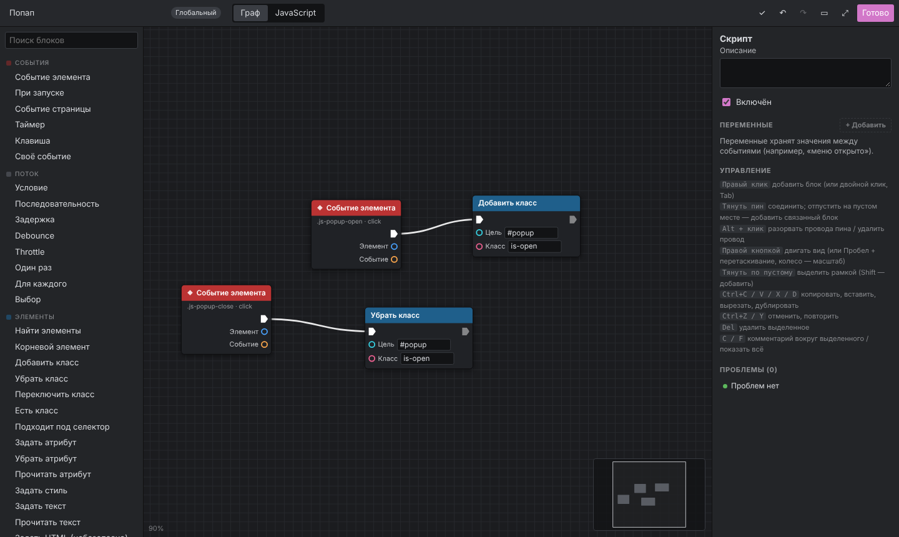

# grapesjs-scripts

Visual scripting for [GrapesJS](https://grapesjs.com). Page behaviour is built from **blueprints** — node graphs in the spirit of Unreal Engine blueprints and n8n — and compiled to plain, readable JavaScript. No framework on the page, no runtime library, no `eval`.



- **Scripts view** next to Layers/Styles: global scripts, template scripts, component scripts, CDN libraries.
- **Blueprint editor**: palette, drag & drop, typed wires, inline values, details panel, variables, comments, minimap, undo/redo, copy/paste, a JavaScript tab with the exact output.
- **Element picker**: click an element in the canvas, choose a selector (or give the element a `js-` class).
- **Preview**: scripts run in the GrapesJS preview only — while editing, a click still selects.
- **Component blocks**: a component script becomes a block with parameters (traits); each instance runs its own copy.
- **CDN libraries** (jsDelivr/npm, cdnjs, popular presets, any URL) with pinned versions and SRI, loaded in the canvas, the preview and the export.
- **Output settings**: separate file or inline, minify (terser), obfuscate (javascript-obfuscator) — both loaded only when switched on.
- Works with **plain GrapesJS 0.21+** — no other plugins needed. Everything is saved in the project data.
- 23 languages for the plugin UI (the GrapesJS core locales + Ukrainian); the blueprint editor in English, Russian and Ukrainian.

A step-by-step article (in Russian): [Popup on a button click — the first blueprint](docs/article-popup.md).

## Installation

```bash
npm install grapesjs-scripts
```

```js
import grapesjs from 'grapesjs';
import scripts from 'grapesjs-scripts';

const editor = grapesjs.init({
  container: '#gjs',
  plugins: [scripts],
  pluginsOpts: {
    [scripts]: {
      // libraries: { proxy: '/plugins/grapesjs-scripts/proxy/libs-proxy.php' },
    },
  },
});
```

Without a bundler:

```html
<script src="https://unpkg.com/grapesjs"></script>
<script src="/path/to/grapesjs-scripts/dist/grapesjs-scripts.umd.cjs"></script>
<script>
  grapesjs.init({ container: '#gjs', plugins: [grapesjsScripts.default] });
</script>
```

## How it works

### Kinds of scripts

| Kind | Runs | Typical use |
|---|---|---|
| **Global** | on every page | popups, menus, anything bound to a selector |
| **Template** | on the chosen `editor.Pages` pages and/or where a CSS condition matches at runtime (`body.tpl-product`) | page-type behaviour |
| **Component** | in every instance of a component type the script defines (a block in the Block Manager) | widgets: accordion, tabs, slider |

### Blueprints

- **Exec pins** (white) set the order of actions; **data pins** carry typed values: `string`, `number`, `boolean`, `element`, `elements`, `event`, `object`, `any`.
- **Event blocks** start chains: element events (delegated to the document — they work on every page and for elements added later), page events, timers, keys, custom events, "on start".
- **Pure blocks** (no exec pins: find elements, math, compare…) are expressions evaluated where their value is used.
- A text value on an element pin is a **CSS selector**.
- One wire per data input and per exec output (as in UE); several actions in a row — **Sequence**. An exec input takes any number of wires.
- A **JavaScript** block runs your own code with typed inputs/outputs (optionally async); **Call function / Create object / Call method** use CDN libraries (`gsap.to`, `new Swiper(el, options)`).

All 63 blocks: [docs/nodes.md](docs/nodes.md) ([по-русски](docs/nodes.ru.md)).

### Blueprint editor

| Action | How |
|---|---|
| Add a block | drag from the palette; right-click, double-click or Tab on the canvas |
| Connect | drag from a pin to a pin; drop on empty space to add a block that fits, already wired |
| Break wires | Alt + click a pin or a wire |
| Move the view / zoom | right-drag or Space + drag / mouse wheel; F fits |
| Select | click, Shift + click, drag a frame on empty space; Ctrl+A |
| Edit | Ctrl+C / V / X / D, Delete, Ctrl+Z / Y; C puts a comment around the selection |
| Pick a selector | the ⌖ button next to a selector field, then click the element in the page |

The editor opens over the whole GrapesJS UI. With [grapesjs-sidebar-tools](https://www.npmjs.com/package/grapesjs-sidebar-tools) 2.2+ it opens in a **document tab** instead (one tab per script, next to the page tabs): switch between the page and its scripts without leaving the editor, split the workspace to keep the page and the graph side by side, close a tab with `×` or **Done**. While you pick a selector, a tab that shares its area with the canvas steps aside to show the page. Open tabs come back after a reload. `workspaceTabs: false` keeps the full-screen editor.

Changes are saved to the script as you go. The **JavaScript** tab shows the exact output; clicking a `// n3 · …` line jumps to the block.

### Preview

Scripts never run while you edit. The GrapesJS **preview** (eye button, or ▶ in the Scripts view) loads the libraries, runs the page scripts and the component scripts in the canvas; leaving the preview stops them and re-renders the page from its components, so nothing they changed stays behind.

### Output

| Setting | Pros | Cons |
|---|---|---|
| **Separate file** (default, `scripts.js`) | cached by the browser; works with a strict CSP | one more file to upload next to the page |
| **Inline** | one HTML file, nothing else to upload | not cached separately; strict CSP needs `'unsafe-inline'` or a hash |
| **Minify** (terser) | smaller | harder to read in DevTools; terser is loaded from a CDN when on |
| **Obfuscate** (javascript-obfuscator) | hard to read | bigger and slower code; not real protection — the browser still runs it |

Template scripts limited to some pages go to their own file (`scripts-<page>.js`) linked only from those pages.

With *Add the tags to the exported HTML* on (default), `editor.getHtml()` carries the library tags and the script tags (or the inline code). Minify/obfuscate are async: `getHtml()` returns the processed code as soon as it is ready (it is prepared after each change); `editor.Scripts.exportPage()` / `exportSite()` always wait for it:

```js
const site = await editor.Scripts.exportSite();
// site.files: [{ name: 'scripts.js', code }], site.pages[pageId]: { libraries, scripts }
```

### Libraries

Add a library from the popular presets, by searching npm (files and SRI hashes through jsDelivr) or cdnjs, or by URL. Versions are always exact. CSS is loaded into the canvas while editing; JS only in the preview (or always, per library). Libraries can be limited to some pages.

The npm registry, jsDelivr and cdnjs APIs are called from the browser. If a host does not answer cross-origin requests in your setup, use the bundled PHP proxy (whitelisted hosts, disk cache, stale copy on failure):

```js
pluginsOpts: { [scripts]: { libraries: { proxy: '/plugins/grapesjs-scripts/proxy/libs-proxy.php' } } }
```

Adding by URL always works.

### Component scripts

A component script defines a GrapesJS component type (`bp-…`): its HTML, CSS and parameters (shown as traits). The script runs inside each instance: **Root element** is the instance, **Component parameter** reads a trait value. The type and a block in the Block Manager are kept in step with the script; on export GrapesJS adds the script (`script-export` with `script-props`) to the page.

## Options

| Option | Default | |
|---|---|---|
| `panelId` | auto | Panel with the view buttons (found by its buttons' commands) |
| `sidebarContainer` | auto | Selector of the element the sidebar goes into |
| `nodes` | `[]` | Your own block definitions (same `type` replaces a built-in) |
| `labels` | `{}` | Plugin UI text overrides |
| `graphLabels` | `{}` | Editor text overrides by key (`ui.*`, `node.<type>`, `desc.<type>`, `cat.<id>`, `label.<English label>`, `diag.<code>`) |
| `injectCss` | `true` | Inject the plugin CSS |
| `storageKey` | `'scripts'` | Key in the project data |
| `libraries` | `{}` | `{ proxy, fetch, timeout }` for the library search |
| `output` | `{}` | `{ tools: { minify, obfuscate } }` your own functions, or `{ urls: { terser, obfuscator } }` |
| `preview` | `true` | Run the scripts in the GrapesJS preview |
| `exportHtml` | `true` | Wrap `editor.getHtml()` (see *Output*) |
| `blocksCategory` | "Scripts" | Block Manager category of component scripts |
| `workspaceTabs` | `true` | With grapesjs-sidebar-tools 2.2+: open the blueprint editor in a document tab (see *Blueprint editor*) |

## API

`editor.Scripts`:

```ts
list(kind?), get(id), create(init), update(id, patchOrFn), rename(id, name), setEnabled(id, on), duplicate(id), remove(id)
build({ pageId, target, only }) // BuildResult: { code, blueprints, diagnostics, hasErrors }
codeOf(id)                      // JavaScript of one script
getSettings(), setSettings(patch)
libraries(), addLibrary(init), updateLibrary(id, patch), removeLibrary(id)
exportPage(pageId?), exportSite()
startPreview(), stopPreview()
addNode(def)
open(), openCreate(kind?), openCode(id?), openSettings(), openLibraryDialog(), edit(id) // → GraphEditor
getGraphEditor(), graphText(), registry, manager
```

**Commands:** `scripts:open`, `scripts:toggle`, `scripts:create` (`{ kind }`), `scripts:edit` (`{ id }`), `scripts:code` (`{ id }` or all), `scripts:build` (`{ pageId, target }`), `scripts:export` (`{ pageId }` or the site, Promise), `scripts:open-settings`, `scripts:add-library`.

**Events:** `scripts:change` (`{ type, id }`), `scripts:add`, `scripts:update`, `scripts:remove`, `scripts:settings`, `scripts:edit`, `scripts:preview` (`{ running }`).

## The blueprint library

Model, compiler and editor work without GrapesJS (`grapesjs-scripts/blueprint`):

```js
import { createRegistry, buildScript, GraphEditor } from 'grapesjs-scripts/blueprint';

const registry = createRegistry();
const { code, diagnostics } = buildScript([blueprint], registry); // a self-starting ES5 script
new GraphEditor({ blueprint, registry, onChange: (bp) => save(bp) }).mount();
```

Writing your own blocks: [docs/custom-nodes.md](docs/custom-nodes.md). Blueprint format: [docs/schema.md](docs/schema.md).

## Security

A blueprint is code that runs on the published site; the **JavaScript** block and **Set HTML** can do anything a script can. In a multi-user CMS only trusted roles should be allowed to save scripts — the server has to enforce it, the editor cannot. Generated literals are safe inside `<script>`; *Set text* never parses HTML. Libraries are pinned to exact versions and carry SRI hashes when the CDN gives them.

## Development

```bash
npm install
npm run typecheck
npm test            # vitest + jsdom, real GrapesJS
npm run build
npm run e2e         # headless Chrome: UI, editor, features, the article (CHROME=/path/to/chrome)
node scripts/gen-nodes.mjs   # docs/nodes*.md from the registry
```

## License

MIT
