# Попап по клику: первый блюпринт

За 10 минут сделаем попап: кнопка открывает его, крестик закрывает. Без строчки кода — блоками и проводами. Потом добавим закрытие по Escape и клику по фону, посмотрим, какой JavaScript получился, и выгрузим его на сайт.

> Все скриншоты сняты автотестом `e2e/article.mjs`, который проходит эти шаги мышью и проверяет, что попап работает. Если интерфейс изменится, статья обновится вместе с ним: `npm run docs:shots`.

## Что понадобится

GrapesJS 0.21+ с плагином `grapesjs-scripts` (других плагинов не нужно) и на странице — разметка попапа:

```html
<button class="js-popup-open">Open popup</button>

<div id="popup" class="popup">
  <div class="popup__dialog">
    <button class="js-popup-close">×</button>
    <p>Hello from the popup!</p>
  </div>
</div>
```

```css
.popup { display: none; position: fixed; inset: 0; background: rgba(0,0,0,.5);
         align-items: center; justify-content: center; }
.popup.is-open { display: flex; }
.popup__dialog { background: #fff; padding: 24px 32px; border-radius: 8px; position: relative; }
.js-popup-close { position: absolute; top: 6px; right: 8px; border: 0; background: none; }
```

Идея простая: попап скрыт, а класс `is-open` его показывает. Скрипту нужно только добавлять и убирать этот класс.

Классы с префиксом `js-` — хорошая привычка: они нужны скриптам, а не оформлению, и дизайнер не удалит их случайно, меняя стили.

## 1. Создаём скрипт

Откройте вкладку **«Скрипты»** (иконка-граф справа, рядом со слоями и стилями) и нажмите **+**. Назовите скрипт «Попап», вид — **«Глобальный»**: он работает на всех страницах сайта.

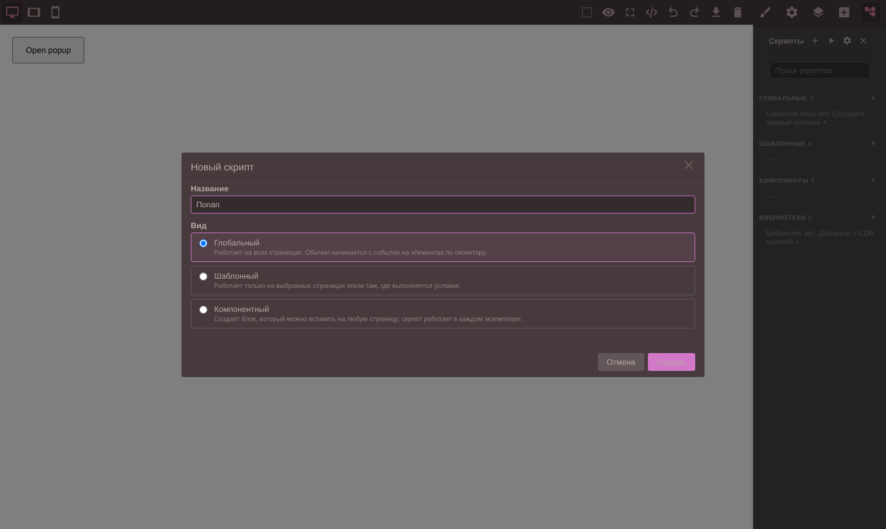

После «Создать» откроется редактор блюпринта. В нём уже есть первый блок — **«Событие элемента»**: всё, что делает скрипт, начинается с события.

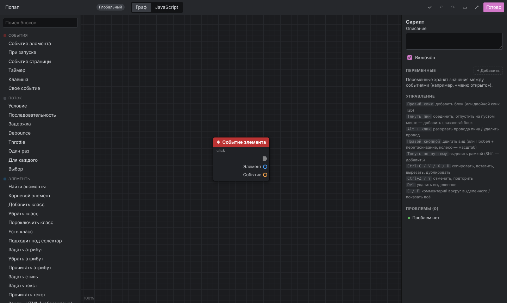

Слева — палитра блоков, в центре — поле, справа — настройки выбранного блока (или всего скрипта, если ничего не выбрано), внизу справа — проблемы.

## 2. На какой кнопке слушать клик

Щёлкните по блоку «Событие элемента». Справа появятся его настройки: **Селектор** и **Событие** (`click` уже стоит).

Селектор можно вписать руками (`.js-popup-open`), но проще пипеткой: нажмите **⌖** рядом с полем. Редактор спрячется, и можно щёлкнуть по кнопке прямо на странице.

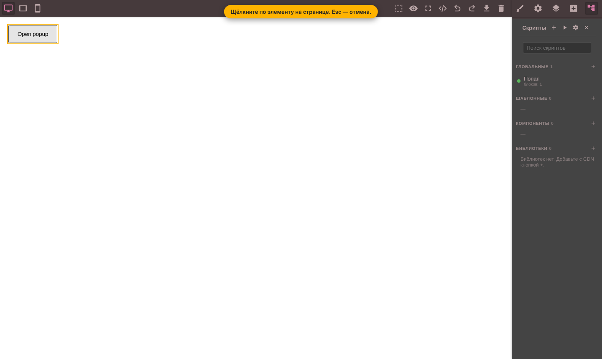

Плагин предложит селекторы, которые подходят этому элементу, и покажет, сколько элементов на странице под каждый попадает:

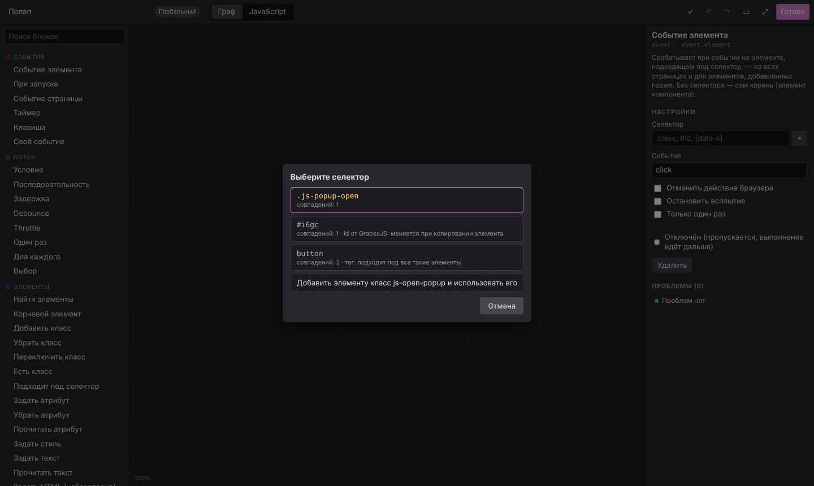

- `.js-popup-open` — то, что нужно: совпадение одно, класс для скрипта.
- `#i…` — id, который придумал GrapesJS. Он меняется при копировании элемента, поэтому помечен как ненадёжный.
- `button` — все кнопки страницы. Слишком широко.
- **«Добавить элементу класс js-…»** — выручает, когда у элемента нет своего класса: плагин добавит класс и выберет его.

Выбираем `.js-popup-open`. Под заголовком блока теперь видно: `.js-popup-open · click`.

## 3. Что сделать при клике

Наберите в поиске палитры «класс» и перетащите блок **«Добавить класс»** на поле.

У блока два входа данных. Впишите прямо в них:

- **Цель** — `#popup`. Текст во входе элемента — это CSS-селектор;
- **Класс** — `is-open`.

Теперь порядок действий. Белые треугольники — это пины выполнения: они говорят, *что за чем* происходит. Потяните от белого выхода «Событие элемента» к белому входу «Добавить класс».

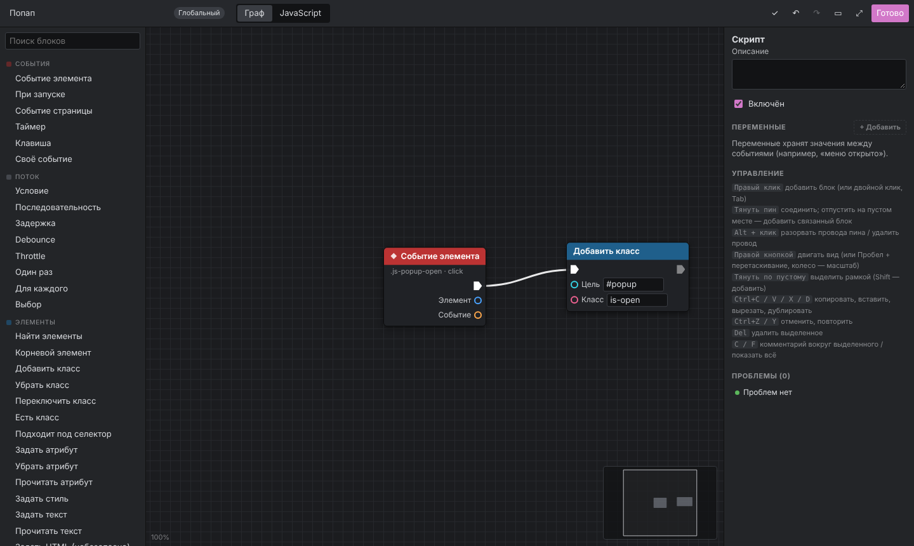

Читается слева направо: *при клике по `.js-popup-open` → добавить `#popup` класс `is-open`*.

## 4. Закрытие

Нужна вторая цепочка — на крестике. Покажем два быстрых способа добавлять блоки.

**Правый клик по пустому месту** открывает поиск блоков. Наберите «событие элемента» и нажмите Enter. В настройках нового блока впишите селектор `.js-popup-close`.

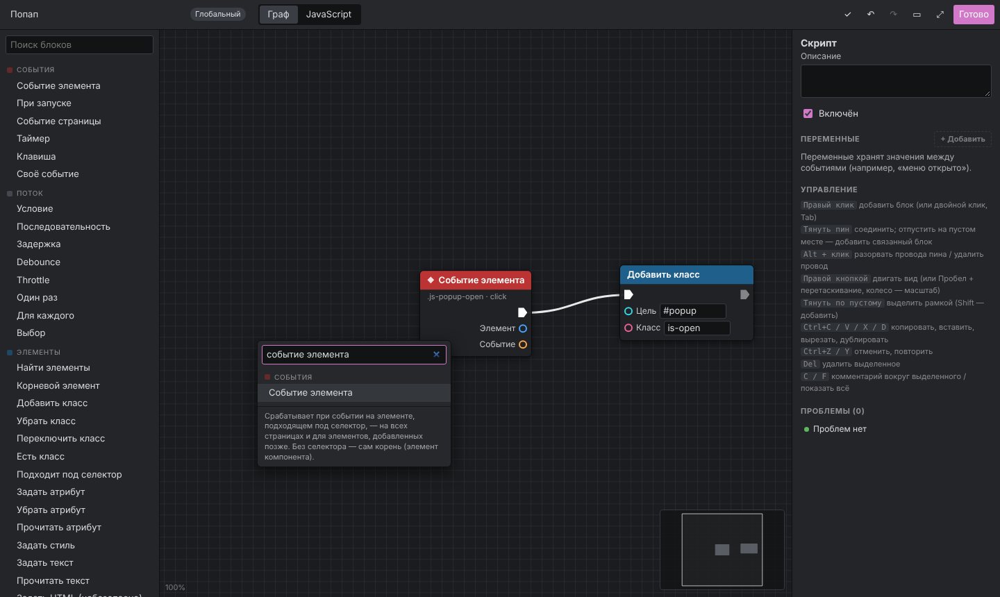

**Провод в пустоту.** Потяните от белого выхода нового события и отпустите на пустом месте. Поиск откроется снова, но покажет только блоки, которые можно подключить к этому выходу. Наберите «убрать класс», нажмите Enter: блок появится уже подключённым. Впишите **Цель** `#popup` и **Класс** `is-open`.

Нажмите **F**, чтобы показать всё:

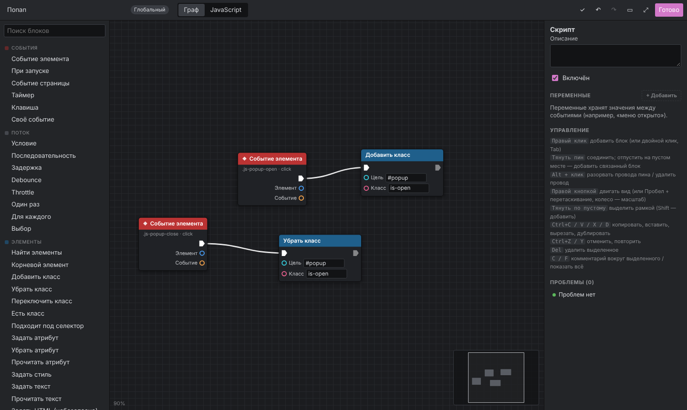

Если что-то не так, внизу справа в **«Проблемах»** будет сказано, что именно: например, «Вход «Цель» не задан». Клик по проблеме выделяет нужный блок.

## 5. Что получилось в коде

Вкладка **JavaScript** показывает ровно тот код, который уйдёт на сайт:

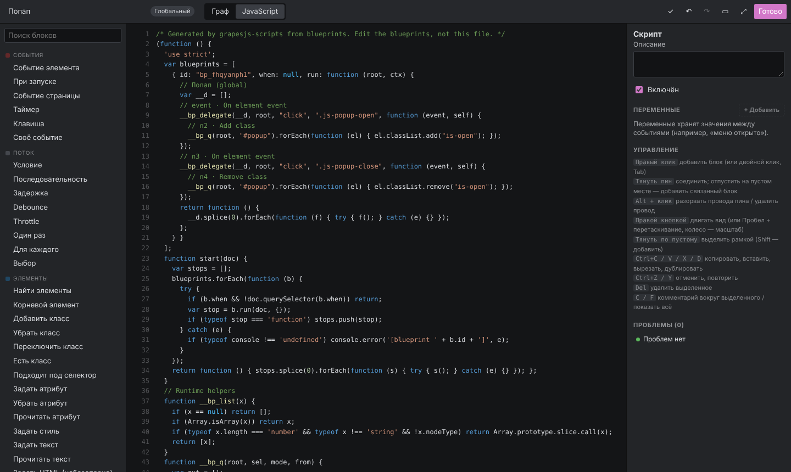

```js
// event · On element event
__bp_delegate(__d, root, "click", ".js-popup-open", function (event, self) {
  // n2 · Add class
  __bp_q(root, "#popup").forEach(function (el) { el.classList.add("is-open"); });
});
```

- Каждому блоку соответствует свой кусок кода с комментарием. Щелчок по строке-комментарию возвращает к блоку на графе.
- Клик слушается на всём документе, а не на самой кнопке. Поэтому скрипт работает на любой странице и для кнопок, которые появятся позже, — например, подгруженных динамически.
- Внизу файла — маленькие вспомогательные функции `__bp_…`. В файл попадают только те, что нужны. Никаких библиотек на сайте нет.

## 6. Проверяем

Нажмите **«Готово»**. Пока вы редактируете страницу, скрипты не выполняются: клик по кнопке выделяет её, как обычно. Чтобы попробовать, включите **превью**: **▶** во вкладке «Скрипты» или «глаз» на панели GrapesJS.

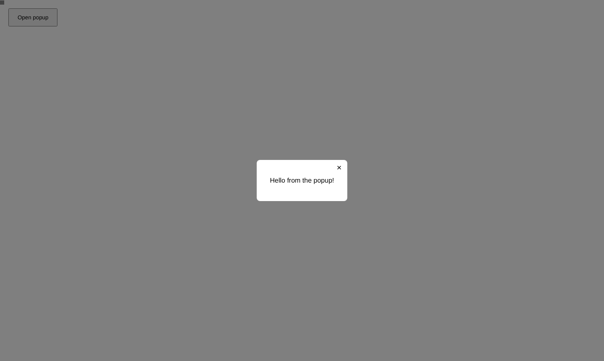

Кнопка открывает попап, крестик закрывает. После выхода из превью страница возвращается к исходному виду: всё, что поменяли скрипты, откатывается.

## 7. Бонус: Escape и клик по фону

Хороший попап закрывается ещё и по Escape и по клику на затемнённый фон. Добавим обе возможности и не будем дублировать «Убрать класс»: в один белый вход можно подключить сколько угодно цепочек.

1. **«Клавиша»** (раздел «События»). Клавиша по умолчанию — `Escape`. Подключите её выход к входу «Убрать класс».
2. **«Событие элемента»** с селектором `.popup`. Есть тонкость: клик *внутри* диалога тоже всплывает до `.popup`, а закрывать нужно только по фону. Поэтому дальше идёт проверка:
   - **«Цель события»** — на чём на самом деле кликнули. Её вход «Событие» — от оранжевого выхода «Событие»;
   - **«Подходит под селектор»** — с селектором `.popup`. Вход «Элемент» — от «Цели события»;
   - **«Условие»** — выполнение идёт от события, «Условие» — от «Результата», а выход **«Да»** — в «Убрать класс».

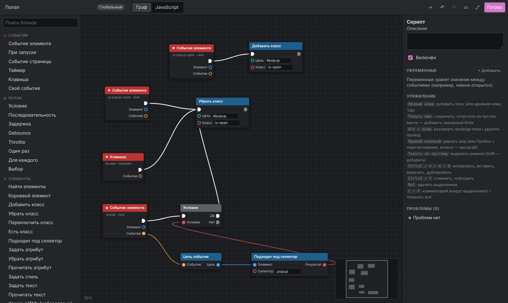

Красный провод — логическое значение («да/нет»), синий — элемент, оранжевый — событие. Неподходящие пины при перетаскивании тускнеют, так что ошибиться трудно.

В превью: клик внутри диалога его не закрывает, а клик по фону и Escape закрывают.

## 8. На сайт

Нажмите **⚙** во вкладке «Скрипты» → **«Экспорт»**:

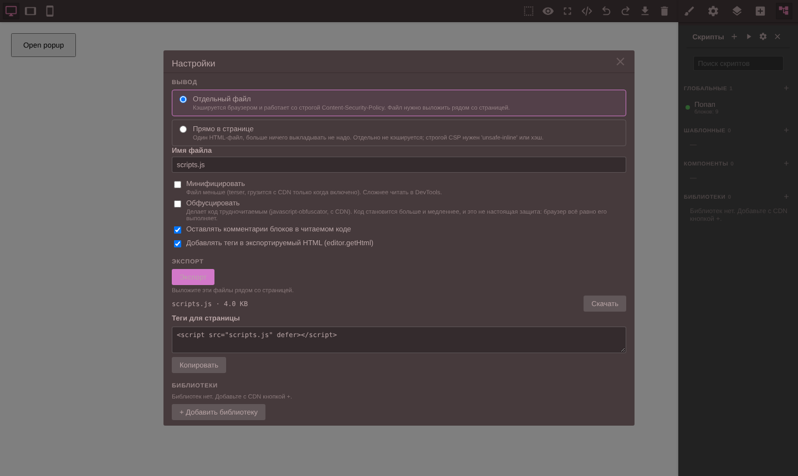

- **Отдельный файл** (по умолчанию). Выложите `scripts.js` рядом со страницей. Тег `<script src="scripts.js" defer>` плагин сам добавит в HTML, который отдаёт `editor.getHtml()`.
- **Прямо в странице** — код встраивается в HTML. Удобно, когда сайт — один файл.
- **Минификация и обфускация** — по желанию. Инструменты для них (terser и javascript-obfuscator) грузятся с CDN, только когда опция включена. Обфускация — не защита: браузер всё равно выполняет код. Скорее «чтобы не читали с первого взгляда».

Из кода это же самое:

```js
const page = await editor.Scripts.exportPage();
page.files;   // [{ name: 'scripts.js', code: '…' }]
page.scripts; // '<script src="scripts.js" defer></script>'
```

## Что дальше

- **Тот же попап компонентом.** Создайте скрипт вида **«Компонентный»** и задайте в настройках скрипта HTML и CSS попапа. В компонентном скрипте селекторы ищутся только внутри своего экземпляра, поэтому тот же граф подойдёт почти без изменений. В Block Manager появится блок «Попап». Каждый вставленный экземпляр работает сам по себе, а параметры скрипта (например, класс открытия) становятся трейтами.
- **Библиотеки.** «Библиотеки → +» подключает GSAP, Swiper, AOS и другие с CDN. Блоки «Вызвать функцию» и «Создать объект» вызывают их без кода: `gsap.to(элемент, { y: 0 })`, `new Swiper(элемент, настройки)`.
- **Свой код.** Блок **JavaScript** — для всего нестандартного: входы и выходы задаются в его настройках.
- Все блоки: [справочник](nodes.ru.md). Как писать свои: [custom-nodes.md](custom-nodes.md) (англ.).
